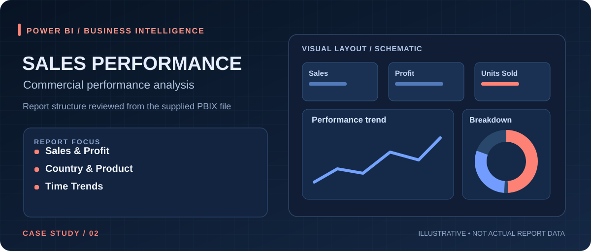

# Sales Performance Overview

**Category:** Sales performance / commercial analytics  
**Tool:** Microsoft Power BI  
**Source examined:** `Sales Performance Overview(1).pbix` (report layout metadata only)

## Project overview

A Power BI sales reporting page that consolidates commercial KPIs with regional, product, customer-segment, and time-based views. The inspected layout contains one page, labeled **Page 1**.

## What the PBIX report structure shows

- **KPI measures:** total sales, total profit, average sale price, total COGS, and total units sold.
- **Profitability:** profit margin shown on a time-based line chart; another line chart uses total profit.
- **Breakdowns:** country-level sales in a donut chart; units sold by country and product in bar charts.
- **Tabular analysis:** sales by segment in a pivot/matrix-style visual.
- **Filter dimensions:** country, year, segment, product, and quarter slicers.
- **Time analysis:** quarter/month hierarchies used for line-chart views.

The report definition includes 14 visuals. Layout metadata was inspected; no claim is made that calculations, refresh, or displayed values were independently validated.

## Business questions it can help explore

1. Which countries and products contribute to sales and units sold?
2. How do profit and profit margin move across time periods?
3. How do segment and time filters change the view of performance?

## Data/publication note

The source `.pbix` contains an embedded data model. This portfolio version includes **no actual sales figures or raw PBIX data**. The case-study illustration is **not a screenshot** of the dashboard. The model table is labeled `financials`, but the data source's publication rights have not been verified.

Once approved for publication, this case study can be enhanced with a sanitized real screenshot and a list of validated analytical findings.

## Validation status

- ✅ Report visuals, model references, and slicer dimensions inspected.
- ✅ Sales and profitability measure names identified.
- ⬜ Data-source provenance and rights not verified.
- ⬜ Actual figures, formulas, and refresh not tested in Power BI Desktop.

[← Back to my GitHub profile](https://github.com/minhaz6996)
